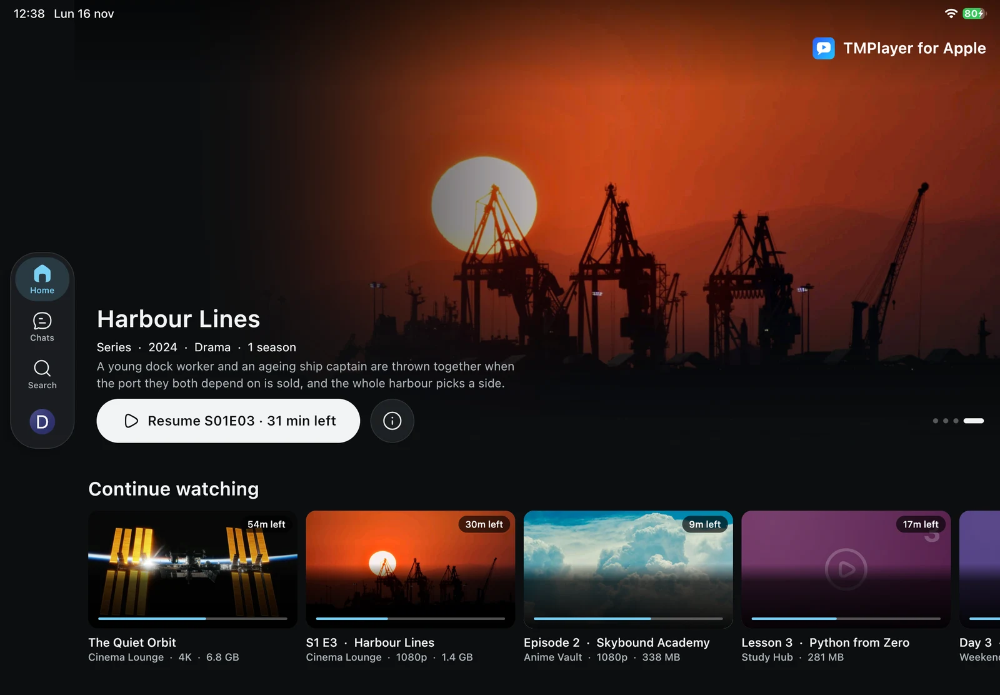
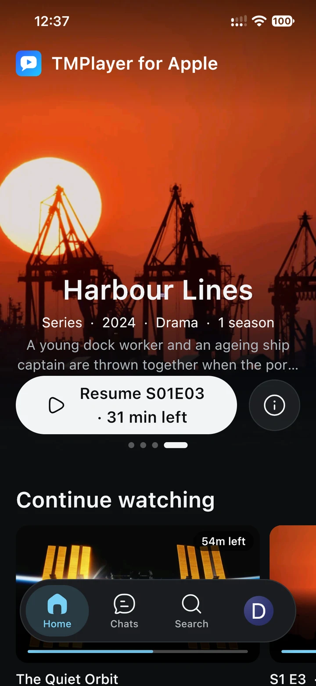
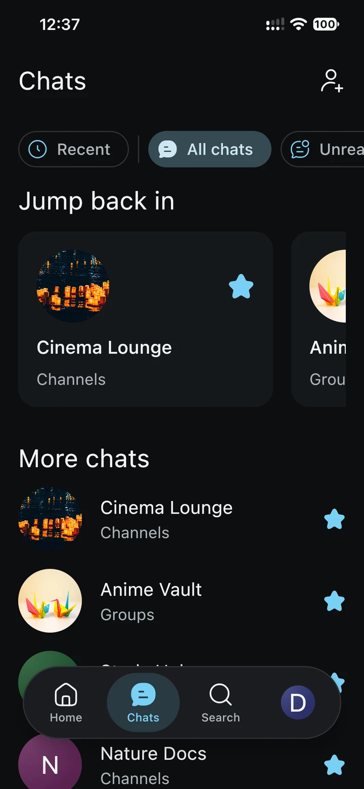
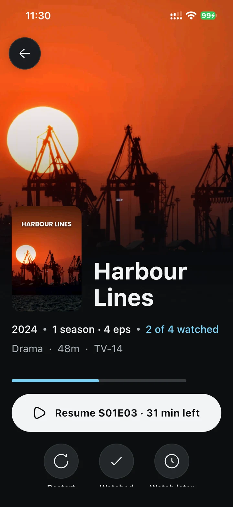
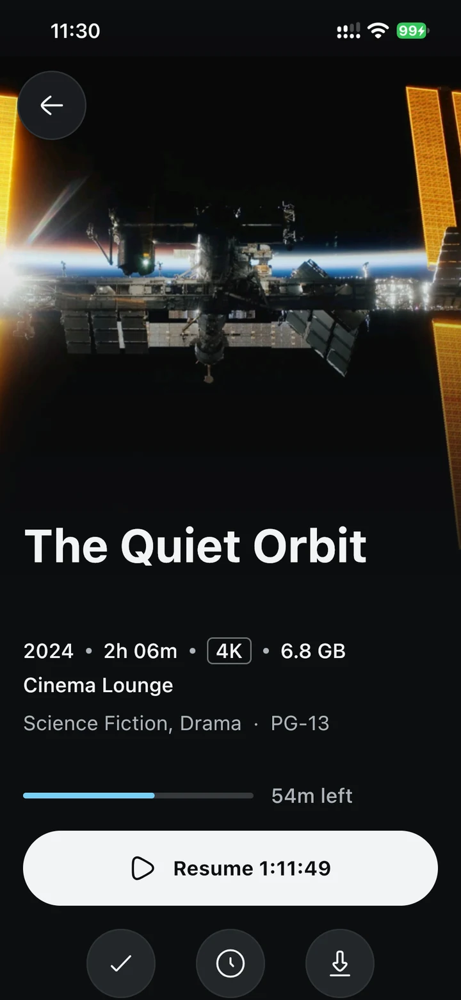
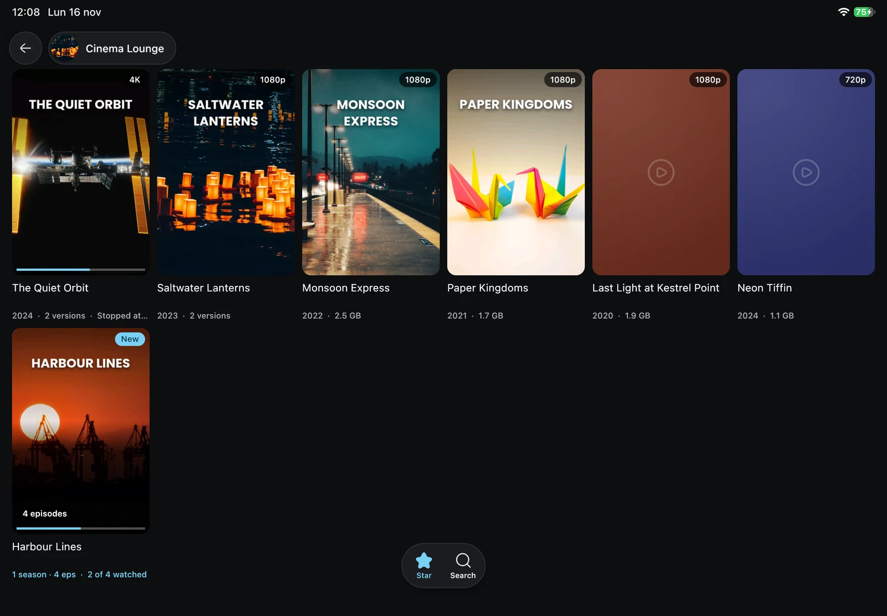
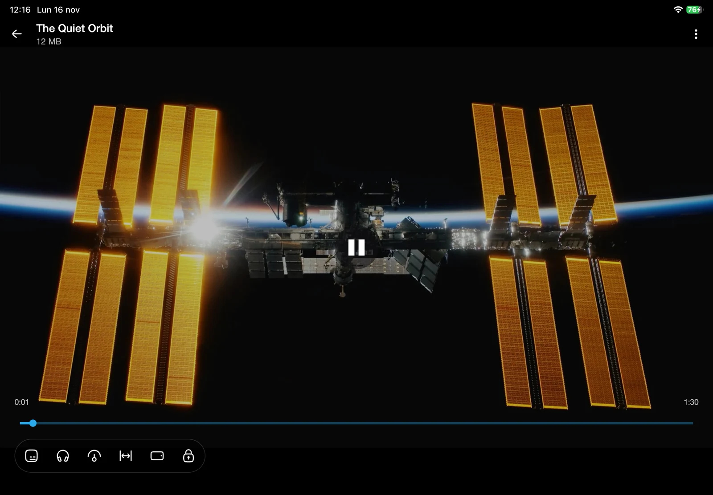

<p align="center">
  
</p>

<h1 align="center">TMPlayer for Apple</h1>

<p align="center"><a href="README.md">English</a> · <b>Italiano</b></p>

<p align="center">I tuoi video di Telegram su iPhone e iPad. Inizia a guardarli prima che il download finisca.</p>

<p align="center"><sub>TMPlayer for Apple è un lettore multimediale per Telegram gratuito, open source e non ufficiale, che riproduce i video delle tue chat di Telegram su iPhone e iPad mentre si stanno ancora scaricando. È la versione per iOS e iPadOS di <a href="https://github.com/dracu-lah/TMPlayer">TMPlayer</a>: per Android TV, Fire TV, telefoni Android, Windows, macOS e Linux, usa il TMPlayer ufficiale.</sub></p>

<p align="center">Realizzata da Pietro Giuseppe D'Amico · <a href="https://pietrogdamico.com">pietrogdamico.com</a></p>

<p align="center">
  
  
</p>

<p align="center">
  <a href="https://buymeacoffee.com/pietrogdamico"></a>
  <a href="https://www.paypal.com/paypalme/pietrogdamico28"></a>
</p>

<p align="center">
  <picture><source media="(prefers-color-scheme: light)" srcset="iosApp/screenshots/ipad/home-light.webp"></picture>
</p>

---

TMPlayer for Apple riproduce i video delle tue chat e dei tuoi canali di Telegram su iPhone o
iPad. Parte in pochi secondi mentre il file si sta ancora scaricando, e quando salti a un altro
punto sposta lì il download invece di aspettarlo.

Accedi con il tuo account Telegram, scegli una chat e compaiono solo i suoi video riproducibili.
Niente messaggi, nessun server, nessun account oltre al tuo.

È [TMPlayer](https://github.com/dracu-lah/TMPlayer), la stessa app con le stesse schermate e lo
stesso comportamento, portata su iPhone e iPad. Il codice di TMPlayer gira su iOS così come l'hanno
scritto i suoi autori; l'unica parte propria di iOS è il motore video. Le modifiche fatte a TMPlayer
arrivano in questa versione unendole.

## Screenshot

### iPhone

<table>
  <tr>
    <td width="25%" align="center" valign="top"><picture><source media="(prefers-color-scheme: light)" srcset="iosApp/screenshots/iphone/home-light.webp"></picture></td>
    <td width="25%" align="center" valign="top"><picture><source media="(prefers-color-scheme: light)" srcset="iosApp/screenshots/iphone/chats-light.webp"></picture></td>
    <td width="25%" align="center" valign="top"><picture><source media="(prefers-color-scheme: light)" srcset="iosApp/screenshots/iphone/show-light.webp"></picture></td>
    <td width="25%" align="center" valign="top"><picture><source media="(prefers-color-scheme: light)" srcset="iosApp/screenshots/iphone/film-light.webp"></picture></td>
  </tr>
  <tr>
    <td width="25%" align="center"><b>Home</b><br /><sub>Una serie da riprendere, Continua a guardare, i video nuovi</sub></td>
    <td width="25%" align="center"><b>Le tue chat</b><br /><sub>Le chat e i canali che hai scelto di guardare</sub></td>
    <td width="25%" align="center"><b>Una serie</b><br /><sub>Stagioni, episodi e dove ti eri fermato</sub></td>
    <td width="25%" align="center"><b>Un video</b><br /><sub>I dettagli, le versioni e cosa puoi farci</sub></td>
  </tr>
</table>

### iPad

<table>
  <tr>
    <td width="50%" align="center" valign="top"><picture><source media="(prefers-color-scheme: light)" srcset="iosApp/screenshots/ipad/grid-light.webp"></picture></td>
    <td width="50%" align="center" valign="top"></td>
  </tr>
  <tr>
    <td width="50%" align="center"><b>I video di una chat</b><br /><sub>I video come locandine, una serie in un solo riquadro</sub></td>
    <td width="50%" align="center"><b>Il player</b><br /><sub>Il lettore di Apple o mpv, con sottotitoli, tracce audio, velocità e gesti</sub></td>
  </tr>
</table>

Screenshot dell'app vera su un iPhone 13 e un iPad (10ª generazione), nel tema chiaro o scuro di
GitHub con cui stai leggendo. La libreria è una demo: ogni chat, titolo e persona è inventato, e
le immagini sono foto di Unsplash, con i crediti in [THIRD_PARTY_NOTICES.md](THIRD_PARTY_NOTICES.md).

## Stato

È uscita la versione 1.28.5, la prima per iPhone e iPad: un IPA nelle [release](https://github.com/Killua99x/TMPlayer-for-apple/releases) e una
sorgente AltStore che la installa e propone ogni aggiornamento (vedi
[Installazione](#installazione)). È nuova: segnala ciò che non funziona, dall'app (Info,
Segnala un problema) o nelle [Issues](https://github.com/Killua99x/TMPlayer-for-apple/issues).

## Dove funziona

- **iPhone** con iOS 26.4 o successivo e **iPad** con iPadOS 26.4 o successivo. Una sola app per
  entrambi. La 26.4 è la versione più vecchia supportata dalla build di TDLib usata qui.
- **Non su Mac.** Il TMPlayer ufficiale ha già un'app per macOS (Apple silicon, macOS 26 Tahoe o
  successivo): la trovi nelle [release di TMPlayer](https://github.com/dracu-lah/TMPlayer/releases).
- **Apple TV** non è ancora supportata. Vorrei portare TMPlayer for Apple anche lì, ma non ho una
  Apple TV: se ci sarà interesse e arriveranno abbastanza donazioni, ne comprerò una e mi ci
  metterò subito al lavoro (vedi [Sostieni il progetto](#sostieni-il-progetto)).

## Cosa fa

- **Accedi come in Telegram.** Con il tuo numero di telefono e il codice che ti manda Telegram,
  oppure con un codice QR da inquadrare con Telegram su un altro dispositivo. La verifica in due
  passaggi funziona in entrambi i casi. Una breve configurazione iniziale chiede poi il tema, la
  dimensione dell'interfaccia e qualche preferenza, e un breve tour mostra dove si trova ogni cosa.
- **Mostra i video, non i messaggi.** Sfogli le chat e i canali che hai già e vedi solo i loro
  video riproducibili. I messaggi di testo non compaiono mai. Ci sono anche i video inviati come
  file, quindi un `.mkv` mandato come documento non ti sfugge.
- **Parte subito e salta come si deve.** La riproduzione inizia mentre il file sta ancora
  arrivando, e quando salti a un altro punto il download si sposta lì. Il lettore mostra quanta
  parte del video è arrivata e a che velocità. Se la tua connessione non sta al passo,
  *Scarica prima l'intero video* nelle Impostazioni lo scarica tutto prima di farlo partire.
- **Riproduce i file come sono davvero.** MKV, MP4, AVI, TS e il resto: gli MP4 con il lettore di
  Apple, che consuma meno batteria, tutto il resto con [mpv](https://mpv.io), entrambi con il
  decodificatore hardware di iPhone e iPad. Sottotitoli incorporati, anche quelli a immagini PGS e
  VobSub, e più tracce audio, da cambiare durante la riproduzione.
- **Riconosce gli episodi.** Nomi di file come `S02E04`, `2x04` o `Season 2 Episode 4` vengono
  riconosciuti sul dispositivo. Precedente e successivo passano tra gli episodi della stessa chat,
  e il successivo parte da solo dopo un conto alla rovescia che puoi fermare.
- **Ricorda dove ti eri fermato.** Ogni video tiene la sua posizione, in Continua a guardare nella
  Home. Metti la stella a una chat per tenerla nei Preferiti.
- **Tiene ciò che scarichi.** Il video che stai guardando resta in cache e viene cancellato quando
  ne riproduci un altro; i video che scarichi restano nei Download di TMPlayer finché non li
  elimini.
- **Locandine e dettagli, se li vuoi.** La configurazione iniziale propone locandine e dettagli da
  TMDB, TVmaze e AniList. Se li lasci spenti, i tuoi video non vengono cercati da nessuna parte.
- **Si adatta all'iPad.** Il layout segue la finestra, a schermo intero o accanto a un'altra app,
  in entrambi gli orientamenti, e una tastiera fisica funziona nel lettore.
- **Uscire dall'account cancella tutto** ciò che l'app ha conservato: la sessione di Telegram, la
  cronologia, i preferiti, le impostazioni e i video scaricati.

L'[elenco delle funzioni](https://github.com/dracu-lah/TMPlayer/blob/main/docs/FEATURES.md) di TMPlayer (in inglese) descrive ogni funzione per
esteso. È scritto per Android, i televisori e i computer, quindi non tutto vale qui: gli elenchi di
questa pagina sono quelli di iPhone e iPad.

## Cosa non fa su iPhone e iPad

- **Nessuna trasmissione ad altri schermi:** niente Google Cast, niente DLNA, niente video via
  AirPlay. La duplicazione dell'intero schermo con AirPlay, dal Centro di Controllo, funziona
  comunque.
- **Niente Picture in Picture.** iOS lo offre solo ai lettori che affidano l'immagine ai livelli
  video di Apple: mpv non lo fa, e il lettore di Apple riproduce solo alcuni file.
- **Niente download in background.** iOS non lascia all'app la sua connessione a Telegram a lungo
  quando non è in primo piano, quindi i download vanno avanti mentre l'app è aperta.
- **Nessun aggiornamento dall'interno dell'app.** Gli aggiornamenti arrivano tramite AltStore o
  SideStore (vedi sotto).

## Installazione

### Con AltStore o SideStore (consigliato)

[AltStore](https://altstore.io) e [SideStore](https://sidestore.io) installano app al di fuori
dell'App Store, firmate con il tuo ID Apple, e le tengono aggiornate da una *sorgente*: un indirizzo
web che elenca le versioni di un'app.

1. Installa AltStore o SideStore su iPhone o iPad, seguendo la sua guida.
2. Copia l'indirizzo della sorgente di TMPlayer for Apple:

   ```
   https://raw.githubusercontent.com/Killua99x/TMPlayer-for-apple/main/altstore/source.json
   ```

3. In AltStore o SideStore apri **Sources**, tocca **+**, incolla l'indirizzo e conferma.
4. Cerca **TMPlayer for Apple** nella sorgente e tocca **Get** (o **Free**). Da lì in poi ogni
   nuova versione compare tra gli aggiornamenti.

Con un ID Apple gratuito, Apple fa funzionare un'app firmata in questo modo per 7 giorni: AltStore
e SideStore la rinnovano prima della scadenza (AltStore quando il computer con AltServer è sulla
stessa rete Wi-Fi, SideStore direttamente sul dispositivo). Un ID Apple gratuito permette inoltre
al massimo 3 app di questo tipo alla volta. Un account sviluppatore Apple a pagamento toglie
entrambi i limiti.

### Con l'IPA

Ogni [release](https://github.com/Killua99x/TMPlayer-for-apple/releases) contiene anche il file `.ipa`, con il suo SHA-256 in `SHA256SUMS.txt`.
Qualsiasi strumento di sideloading può installarlo, per esempio Sideloadly; in quel caso gli
aggiornamenti sono a carico tuo, installando l'IPA della release successiva.

## Compilarla da sé

Ti servono un Mac con **Xcode 26.4 o successivo** (l'SDK di iOS 26.4), **JDK 21** (con Homebrew,
`brew install openjdk@21`) e le tue credenziali gratuite di Telegram, da
[my.telegram.org](https://my.telegram.org), in `local.properties` nella cartella principale del
repository:

```properties
sdk.dir=/path/to/Android/Sdk
TG_API_ID=1234567
TG_API_HASH=your_api_hash
```

`sdk.dir` c'è perché la stessa build Gradle contiene l'app Android di TMPlayer, che Gradle prepara
anche quando compila per iOS: serve il percorso dell'SDK di Android (quello di Android Studio o dei
command line tools), non un dispositivo Android. Senza le credenziali l'app si compila e lo dice,
invece di proporre l'accesso. Poi apri `iosApp/TMPlayer.xcodeproj` ed esegui lo schema `TMPlayer`.
Su iPhone o iPad imposta prima il tuo team di sviluppo Apple in **Signing & Capabilities** del
target; il simulatore richiede un Mac con Apple silicon. La prima fase di build di Xcode avvia
Gradle, che trova JDK 21 da solo.

Da riga di comando:

```bash
xcodebuild -project iosApp/TMPlayer.xcodeproj -scheme TMPlayer -destination 'generic/platform=iOS Simulator' build
```

I test girano sul simulatore:

```bash
./gradlew :core:iosSimulatorArm64Test :ui:iosSimulatorArm64Test :ios:iosSimulatorArm64Test
```

Un IPA di release, come quelli pubblicati, si ottiene con
`iosApp/release/build-ipa.sh <versione> <build> <cartella>`. Sta in un Mac da 8 GB: il collegamento
ottimizzato della parte Kotlin gira da solo, con circa 6 GB, per una ventina di minuti.

## Come è fatta

- **Il codice di TMPlayer, invariato.** Il suo codice Kotlin (le schermate, i controlli del
  lettore, i download, le impostazioni) viene compilato per iOS con Kotlin/Native e
  [Compose Multiplatform](https://www.jetbrains.com/compose-multiplatform/). Dove chiama le API di
  Android o di Java, questo repository ne fornisce versioni fatte per iOS, così gli stessi file si
  compilano per entrambi.
- **Telegram tramite TDLib,** la libreria client di Telegram, attraverso
  [tdl-coroutines](https://github.com/g000sha256/tdl-coroutines).
- **Il video tramite il lettore di Apple (AVPlayer)** per i file MP4 e QuickTime, e **libmpv** di
  [MPVKit](https://github.com/mpvkit/MPVKit), nella sua build LGPL, con FFmpeg, la decodifica
  hardware di VideoToolbox e [MoltenVK](https://github.com/KhronosGroup/MoltenVK) per l'immagine,
  per il resto. Sono l'unica parte propria di iOS, dietro gli stessi comandi che il lettore Android
  dà al suo motore, e l'impostazione Decoder di Android sceglie tra i due.
- **Il più leggera possibile.** Misurata sui dispositivi: nessun lavoro quando sullo schermo non
  cambia nulla, nessun thread lasciato ad aspettare a vuoto, immagini tenute entro un limite di
  memoria fisso.

## Sostieni il progetto

TMPlayer for Apple non ha pubblicità sua (i messaggi sponsorizzati di Telegram compaiono nei canali
pubblici, come Telegram richiede) e nessuna versione a pagamento. Le donazioni pagano i dispositivi
e gli strumenti Apple con cui viene sviluppata e provata.

**Una versione per Apple TV** è quella che vorrei fare dopo, ma non ho una Apple TV su cui
svilupparla e provarla. Se ci sarà interesse e le donazioni lo permetteranno, ne comprerò una e mi
ci metterò subito al lavoro. Se la useresti, dillo nelle [Issues](../../issues) di questo
repository.

- [Offrimi un caffè](https://buymeacoffee.com/pietrogdamico)
- [PayPal](https://www.paypal.com/paypalme/pietrogdamico28)

TMPlayer è fatto da dracu-lah: puoi sostenere anche lui, tramite
[GitHub Sponsors](https://github.com/sponsors/dracu-lah). In ogni caso, una stella aiuta chi arriva
dopo a fidarsi.

**Bug e richieste** per iPhone e iPad vanno nelle [Issues](../../issues) di questo repository. Per
Android, i televisori e i computer, usa [quelle di TMPlayer](https://github.com/dracu-lah/TMPlayer/issues).

## Domande

**Perché non è sull'App Store?** TMPlayer è distribuito con licenza GPL 3.0, e i termini dell'App
Store sono in conflitto con essa: uno qualsiasi dei suoi autori potrebbe far rimuovere l'app.
Servirebbe un permesso scritto degli autori di TMPlayer. AltStore e SideStore non ne hanno bisogno.

**È sicuro accedere?** L'app parla direttamente con Telegram tramite TDLib, come fanno le app di
Telegram stesse. Non c'è nessun server di questo progetto in mezzo, nessuna statistica d'uso e
nessuna segnalazione dei crash. La tua sessione resta sul dispositivo finché non esci
dall'account.

**Funziona senza un account sviluppatore Apple?** Sì. Basta un ID Apple gratuito per AltStore,
SideStore e per compilarla da sé; la differenza è il rinnovo ogni 7 giorni.

## Note legali

Client non ufficiale. Non affiliato, approvato o collegato in alcun modo a Telegram FZ-LLC, né ad
Apple Inc. Usa l'API ufficiale di Telegram tramite TDLib con il tuo account Telegram, come
[consentito ai client di terze parti](https://core.telegram.org/api/obtaining_api_id). iPhone, iPad
e Apple TV sono marchi di Apple Inc.

TMPlayer for Apple non fornisce contenuti, non consiglia canali e non aggira i controlli di
accesso. Le restrizioni di Telegram restano attive. Usala solo con contenuti di tua proprietà o a
cui sei autorizzato ad accedere, come dice la pagina [Lawful use](https://tmplayer.org/legal/) di
TMPlayer (in inglese).

TMPlayer for Apple è un porting indipendente: non è pubblicato né supportato dallo sviluppatore di
TMPlayer, quindi problemi e domande vanno nelle
[issue](https://github.com/Killua99x/TMPlayer-for-apple/issues) di questo repository, non in quelle
di TMPlayer.

Cosa l'app conserva sul dispositivo e con quali servizi parla è nella pagina [Privacy](PRIVACY.it.md).

## Licenza

[GNU GPL-3.0-or-later](LICENSE) © 2026 dracu-lah, con un
[permesso aggiuntivo per OpenSSL](LICENSE-OPENSSL-EXCEPTION.md) (TDLib usa OpenSSL). Il porting
per iOS e iPadOS, di Pietro Giuseppe D'Amico ([pietrogdamico.com](https://pietrogdamico.com)), è
pubblicato con la stessa licenza.

TMPlayer for Apple è una versione modificata di [TMPlayer](https://github.com/dracu-lah/TMPlayer)
di dracu-lah. Cosa è cambiato, da novembre 2026: il porting per iOS e iPadOS (il modulo `ios`,
`iosApp/`, i sorgenti e i sostituti per iOS in `core` e `ui`, e i passaggi di build che
compilano le schermate di TMPlayer per iOS), più nome, icona e link propri. Il resto è il codice
di TMPlayer come l'ha scritto il suo sviluppatore, al passo con le sue versioni. Il nome TMPlayer
e il suo simbolo appartengono al progetto originale: questa versione è pubblicata come TMPlayer
for Apple, con un'icona propria, come concordato con lo sviluppatore di TMPlayer (16 novembre
2026).

La build per iOS aggiunge TDLib (Boost Software License 1.0) tramite tdl-coroutines (Apache
License 2.0), libmpv e FFmpeg nelle loro build LGPL tramite MPVKit, MoltenVK (Apache License 2.0),
e Kotlin e Compose Multiplatform (Apache License 2.0). Le librerie incluse in TMPlayer stesso sono
elencate in [THIRD_PARTY_NOTICES.md](THIRD_PARTY_NOTICES.md).

L'icona di TMPlayer for Apple, un fumetto con il triangolo del play ([iosApp/art](iosApp/art)), è
stata fatta per questo progetto ed è pubblicata con la stessa licenza.
